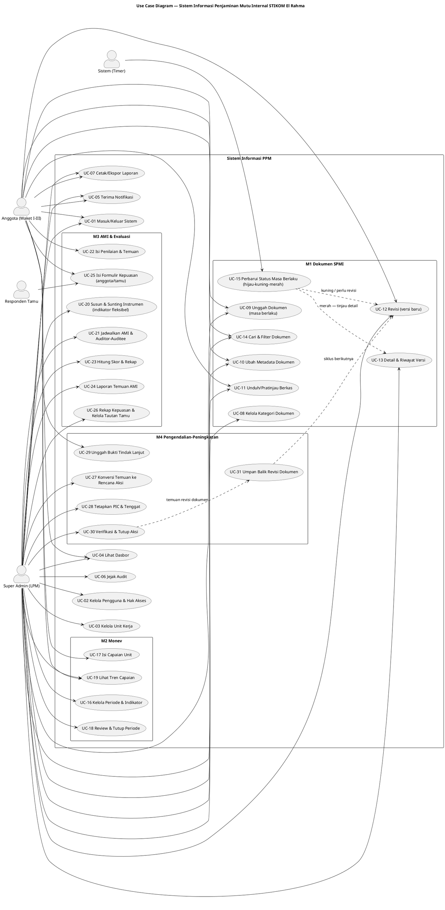

# 01 — USE CASE DIAGRAM & DAFTAR USE CASE

## A. Aktor

| Kode | Aktor | Peran | Keterangan |
|---|---|---|---|
| A1 | **Super Admin (LPM)** | Pengelola sistem | Mengelola pengguna, dokumen, instrumen, jadwal, verifikasi tindak lanjut, laporan |
| A2 | **Anggota (Waket I–III)** | Pengguna operasional | Mengisi Monev, mengunggah bukti penilaian AMI (sebagai auditee), mengunggah dokumen unit, mengisi kepuasan |
| A3 | **Sistem** *(aktor sekunder)* | Timer & otomasi | Mengubah status masa berlaku dokumen, mengirim notifikasi tenggat |
| A4 | **Responden Tamu** | Pengguna tanpa akun | Mengisi formulir kepuasan melalui tautan token (mis. mahasiswa) |

> Sesuai hasil wawancara LPM: **LPM = Super Admin; Waket I, II, III = Anggota.** Auditor AMI ditetapkan sebagai penugasan (*assignment*) — **auditor berasal dari unit LPM** dan **auditee dari unit waket (W1–W3)**.

## B. Daftar Use Case

| Kode | Use Case | Aktor | Modul | Ringkas |
|---|---|---|---|---|
| **Umum & M5** ||||
| UC-01 | Masuk / keluar sistem | A1, A2 | M5 | Autentikasi, sesi, profil |
| UC-02 | Kelola pengguna & hak akses | A1 | M5 | Tambah/ubah/nonaktifkan pengguna, tetapkan role |
| UC-03 | Kelola unit kerja | A1 | M5 | Unit beserta penanggung jawab |
| UC-04 | Lihat dasbor | A1, A2 | M5 | Ringkasan capaian, temuan, dokumen kritis |
| UC-05 | Terima notifikasi | A1, A2 | M5 | Pengingat masa berlaku, tenggat, temuan, verifikasi |
| UC-06 | Jejak audit | A1 | M5 | Meninjau riwayat aksi penting |
| UC-07 | Cetak / ekspor laporan | A1, A2 | M5 | PDF & Excel |
| **M1 — Dokumen SPMI** ||||
| UC-08 | Kelola kategori dokumen | A1 | M1 | Hierarki: kebijakan→pedoman→manual/SOP→instrumen→laporan |
| UC-09 | Unggah dokumen | A1, A2 | M1 | Metadata: nomor, versi, tanggal & **masa berlaku**, berkas |
| UC-10 | Ubah metadata dokumen | A1, A2 | M1 | Judul, nomor, masa berlaku, deskripsi (pemilik/unit) |
| UC-11 | Unduh / pratinjau berkas | A1, A2 | M1 | Berkas dokumen sesuai hak akses |
| UC-12 | Revisi dokumen (versi baru) | A1, A2 | M1 | Versi sebelumnya diarsipkan, riwayat tersimpan |
| UC-13 | Lihat detail & riwayat versi | A1, A2 | M1 | Pratinjau berkas, metadata, riwayat versi sebelumnya |
| UC-14 | Cari & filter dokumen | A1, A2 | M1 | Kategori, status, masa berlaku, kata kunci |
| UC-15 | Perbarui status masa berlaku *(aktor sistem)* | A3 | M1 | 🟢 hijau → 🟡 kuning (H-30) → 🔴 merah (kedaluwarsa) |
| **M2 — Monev** ||||
| UC-16 | Kelola periode & indikator Monev | A1 | M2 | Periode 3-bulanan, daftar indikator standar |
| UC-17 | Isi capaian unit | A2 | M2 | Nilai per indikator + unggah bukti |
| UC-18 | Review & tutup periode | A1 | M2 | Rekap, tandai selesai |
| UC-19 | Lihat tren capaian | A1, A2 | M2 | Grafik antarperiode & antarunit, status lampu |
| **M3 — AMI & Evaluasi** ||||
| UC-20 | Susun & sunting instrumen AMI | A1 | M3 | **Indikator fleksibel**: tambah/ubah/hapus + jejak perubahan |
| UC-21 | Jadwalkan AMI & tetapkan auditor–auditee | A1 | M3 | Tahunan; auditor wajib unit LPM, auditee unit waket |
| UC-22 | Unggah bukti & beri skor temuan | A2, A1 | M3 | Auditee unggah bukti (skor kosong); auditor LPM menilai 0–4 + temuan |
| UC-23 | Hitung skor & rekap otomatis | A1 | M3 | Skor per unit, per standar, per indikator |
| UC-24 | Susun laporan temuan AMI | A1 | M3 | Laporan siap ekspor |
| UC-25 | Isi formulir kepuasan | A2, A4 | M3 | Kuisioner periode berjalan — anggota (akun) atau Tamu (tautan `/puas/{token}`) |
| UC-26 | Rekap kepuasan & kelola tautan tamu | A1 | M3 | Skor & grafik; aktifkan/nonaktifkan tautan tamu |
| **M4 — Pengendalian–Peningkatan** ||||
| UC-27 | Konversi temuan menjadi rencana aksi | A1 | M4 | Otomatis dari UC-22/UC-23 |
| UC-28 | Tetapkan penanggung jawab & tenggat | A1 | M4 | PIC dari Waket terkait |
| UC-29 | Laksanakan & unggah bukti | A2 | M4 | Status Terbuka → Berjalan → Selesai |
| UC-30 | Verifikasi & tutup tindak lanjut | A1 | M4 | Terverifikasi; bukti ditolak → kembali Berjalan |
| UC-31 | Umpan balik revisi dokumen | A1 | M4 | Memicu UC-12 (revisi dokumen = masuk siklus berikutnya) |

## C. PlantUML — Use Case Diagram

> Salin ke https://www.plantuml.com/plantuml/uml atau impor ke StarUML (plugin PlantUML) → ekspor PNG ke `skripsi/05-gambar/gambar-4-x-usecase.png`.

## D. Aturan hak akses (untuk implementasi RBAC)

| Aktor | M1 | M2 | M3 | M4 | M5 |
|---|---|---|---|---|---|
| Super Admin (LPM) | C R U D | C R U D + tutup periode | C R U D + instrumen + penilaian + verifikasi + tautan tamu | C R U D + verifikasi | Kelola pengguna, jejak audit, ekspor |
| Anggota (Waket) | U (unit sendiri), unduh, revisi | R (semua) + U (capaian bidang) | R + U (bukti auditee bidang) + isi kepuasan | R + U (unggah bukti PIC-nya) | Dasbor, notifikasi, ekspor |
| Responden Tamu | – | – | R + isi (formulir via tautan token) | – | – |

Keterangan: C=Create, R=Read, U=Update, D=Delete.
