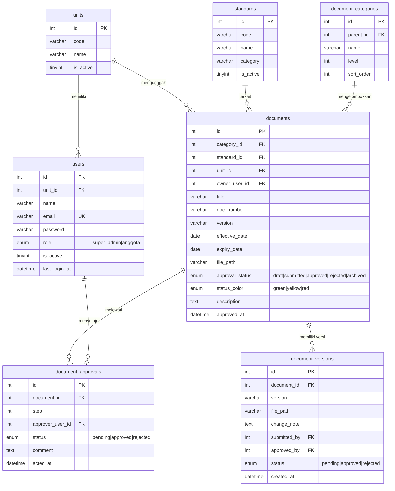
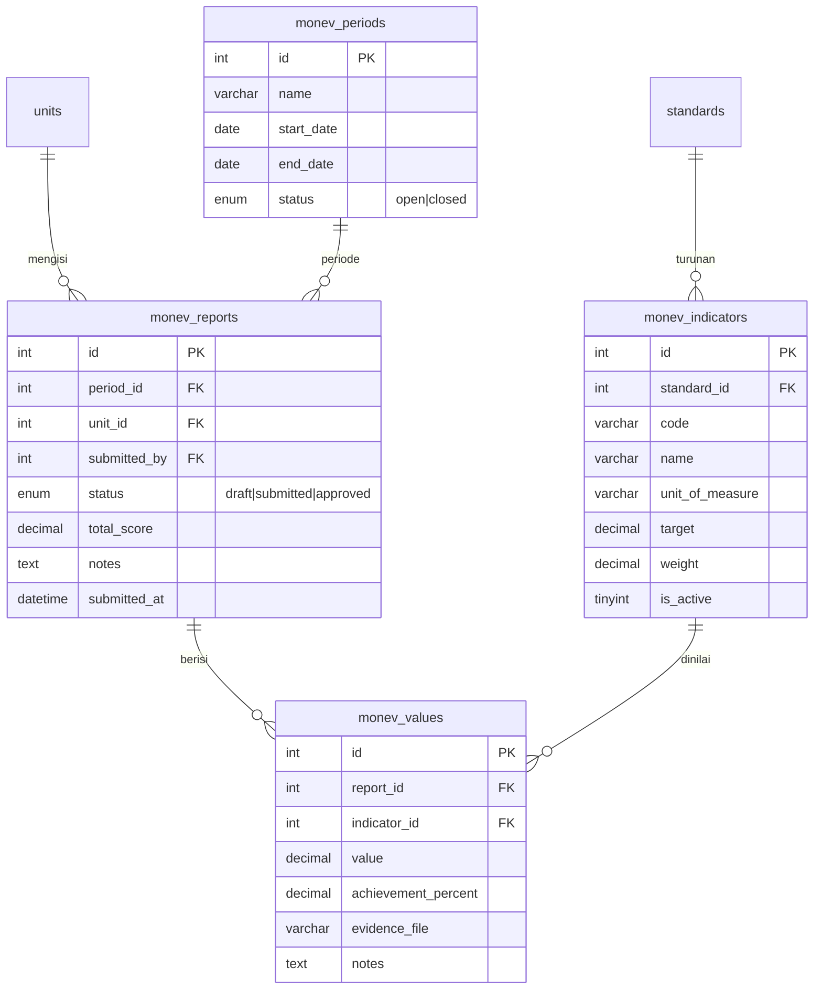
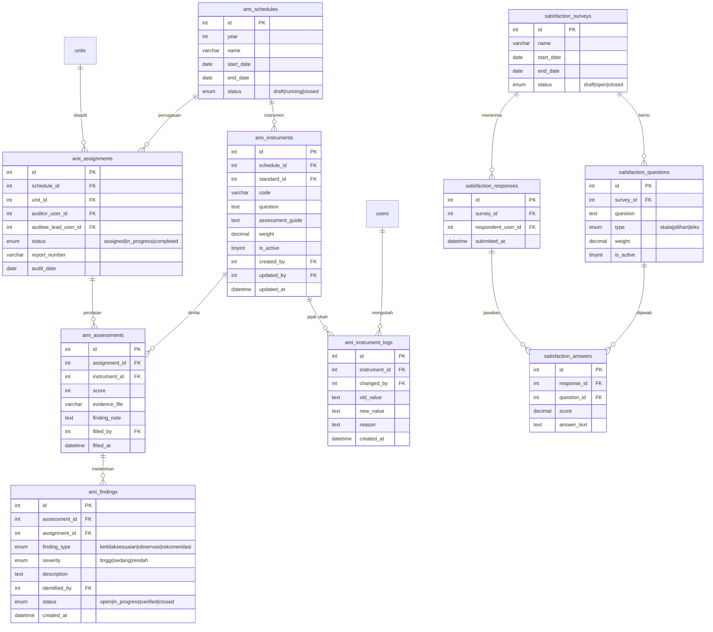
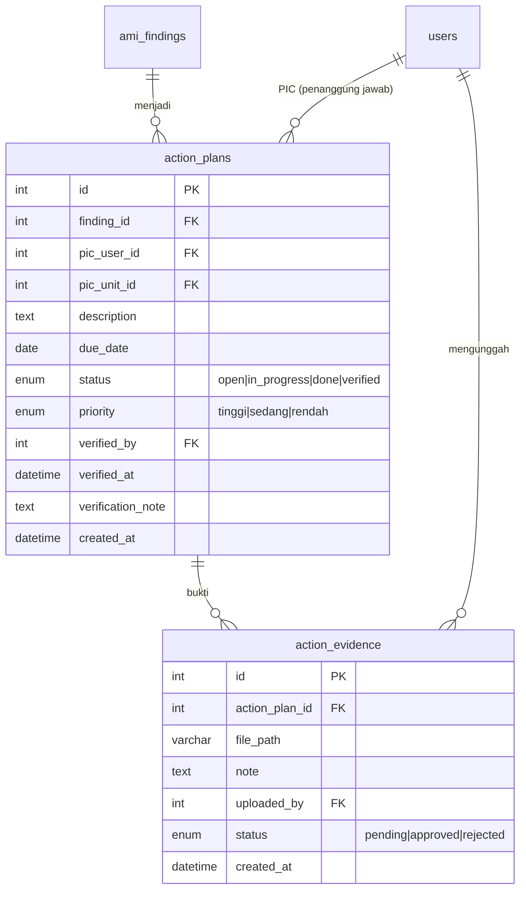
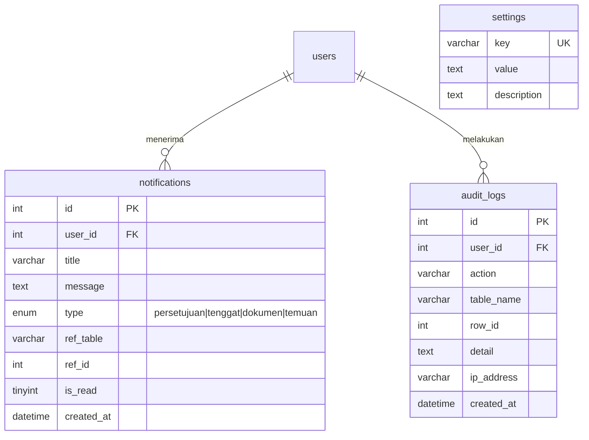

# 02 — ENTITY RELATIONSHIP DIAGRAM (ERD)

## A. Daftar Entitas

| # | Entitas (Tabel) | Penjelasan | Kunci Utama |
|---|---|---|---|
| 1 | `units` | Unit kerja / bidang (LPM, Akademik, dst.) | `id` |
| 2 | `users` | Pengguna: **super_admin** (LPM) & **anggota** (Waket I–IV) | `id` |
| 3 | `standards` | Standar SPMI (Pendidikan, Penelitian, Pengabdian, SDM, Sarpras, Pembiayaan, Penjaminan Mutu, Data & Informasi) | `id` |
| 4 | `document_categories` | Hierarki dokumen (Kebijakan→Pedoman→Manual/SOP→Instrumen→Formulir→Laporan), mendukung **M1** | `id` |
| 5 | `documents` | Dokumen SPMI: nomor, versi, **tanggal & masa berlaku**, **status 🟢🟡🔴**, status persetujuan | `id` |
| 6 | `document_versions` | Riwayat versi setiap dokumen | `id` |
| 7 | `document_approvals` | Alur persetujuan berjenjang | `id` |
| 8 | `monev_periods` | Periode Monev (**6 bulan sekali**) | `id` |
| 9 | `monev_indicators` | Indikator capaian (turunan standar) untuk **M2** | `id` |
| 10 | `monev_reports` | Laporan capaian satu unit pada satu periode | `id` |
| 11 | `monev_values` | Nilai capaian per indikator + unggahan bukti | `id` |
| 12 | `ami_schedules` | Jadwal AMI **tahunan** (M3) | `id` |
| 13 | `ami_instruments` | Instrumen AMI — **indikator fleksibel (bisa diedit)** | `id` |
| 14 | `ami_instrument_logs` | Jejak perubahan instrumen (siapa, kapan, apa yang berubah) | `id` |
| 15 | `ami_assignments` | Penugasan pasangan **auditor–auditee** per unit | `id` |
| 16 | `ami_assessments` | Penilaian per indikator: skor 0–4, bukti | `id` |
| 17 | `ami_findings` | Temuan hasil penilaian | `id` |
| 18 | `action_plans` | **Rencana tindak lanjut**: PIC, tenggat, status | `id` |
| 19 | `action_evidence` | Bukti penyelesaian + status verifikasi | `id` |
| 20 | `satisfaction_surveys` | **Formulir kepuasan** periode tertentu | `id` |
| 21 | `satisfaction_questions` | Pertanyaan kepuasan | `id` |
| 22 | `satisfaction_responses` | Satu jawaban responden | `id` |
| 23 | `satisfaction_answers` | Skor per pertanyaan | `id` |
| 24 | `notifications` | Notifikasi pengguna (M5) | `id` |
| 25 | `audit_logs` | Jejak audit seluruh aksi penting (M5) | `id` |
| 26 | `settings` | Pengaturan sistem (nama PT, logo, dst.) | `key` |

## B. Relasi

| # | Relasi | Kardinalitas | Keterangan |
|---|---|---|---|
| R1 | `units` → `users` | 1 : N | Satu unit punya banyak pengguna |
| R2 | `units` → `monev_reports` | 1 : N | Laporan per unit per periode |
| R3 | `units` → `ami_assignments` | 1 : N | Satu unit diaudit tiap tahun |
| R4 | `standards` → `documents` | 1 : N | Dokumen terkait satu standar |
| R5 | `standards` → `monev_indicators` | 1 : N | Indikator turunan standar |
| R6 | `standards` → `ami_instruments` | 1 : N | Instrumen turunan standar |
| R7 | `document_categories` → `documents` | 1 : N | Kategori berjenjang |
| R8 | `documents` → `document_versions` | 1 : N | Riwayat versi |
| R9 | `documents` → `document_approvals` | 1 : N | Alur persetujuan |
| R10 | `users` → `documents` | 1 : N | Pemilik / pengunggah dokumen |
| R11 | `monev_periods` → `monev_reports` | 1 : N | Satu periode, banyak unit |
| R12 | `monev_reports` → `monev_values` | 1 : N | Nilai tiap indikator |
| R13 | `monev_indicators` → `monev_values` | 1 : N | Indikator dinilai banyak periode |
| R14 | `ami_schedules` → `ami_instruments` | 1 : N | Instrumen per tahun AMI |
| R15 | `ami_schedules` → `ami_assignments` | 1 : N | Penugasan auditor per tahun |
| R16 | `ami_assignments` → `ami_assessments` | 1 : N | Penilaian per unit |
| R17 | `ami_instruments` → `ami_assessments` | 1 : N | Indikator dinilai banyak unit |
| R18 | `ami_assessments` → `ami_findings` | 1 : N | Satu penilaian dapat melahirkan temuan |
| R19 | `ami_findings` → `action_plans` | 1 : N | Satu temuan bisa punya beberapa aksi |
| R20 | `action_plans` → `action_evidence` | 1 : N | Beberapa bukti per aksi |
| R21 | `satisfaction_surveys` → `satisfaction_questions` / `responses` | 1 : N | Formulir & isian |
| R22 | `satisfaction_responses` → `satisfaction_answers` | 1 : N | Jawaban per pertanyaan |
| R23 | `users` → `notifications` / `audit_logs` | 1 : N | Jejak & pemberitahuan |

## C. Mermaid ERD (bagian per modul)

> Salin ke https://mermaid.live → ekspor PNG → `skripsi/05-gambar/`.

### C.1 M1 — Dokumen SPMI



### C.2 M2 — Monev



### C.3 M3 — AMI & Evaluasi (+ Formulir Kepuasan)



### C.4 M4 — Pengendalian–Peningkatan



### C.5 M5 — Pendukung



## D. Alur data lintas modul (inti "terintegrasi")

```
M1 Dokumen ──(bukti)──► M2 Monev ──(capaian)──► M3 AMI ──(temuan)──► M4 Aksi
   ▲                                                                    │
   └────────── revisi dokumen (umpan balik, UC-31) ◄─────────────────────┘
```

Temuan pada M3 otomatis menjadi entri `action_plans` (M4); bukti yang diverifikasi pada M4 dapat memicu revisi dokumen pada M1 — inilah wujud **siklus PPEPP tertutup** dalam skema data.
