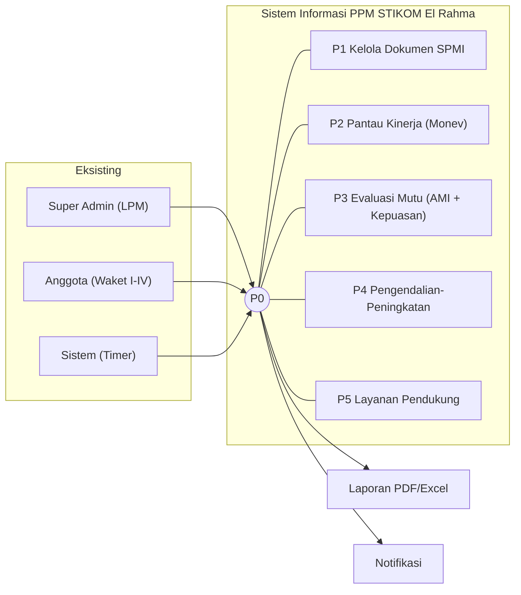

# 04 — DATA FLOW DIAGRAM (DFD)

## A. DFD Level 0 (Konteks)

```
                    ┌──────────────────────────────────────────┐
   Super Admin ────►│                                          │────► Laporan (PDF/Excel)
   (LPM)            │   P0  SISTEM INFORMASI PENJAMINAN        │
   Anggota ────────►│       MUTU INTERNAL – STIKOM EL RAHMA     │
   (Waket I–IV)     │                                          │────► Notifikasi
                    └──────────────────────────────────────────┘
                              ▲                │
                              │                ▼
                         Data mutu        Status, skor,
                         (input)          temuan, aksi
```

**Aliran utama (Level 1):**

```
 Super Admin/Anggota
        │  (1) unggah dokumen & metadata, masa berlaku
        ▼
  ┌─────────────┐  status 🟢🟡🔴   ┌─────────────┐
  │ P1 Kelola   │ ───────────────► │ P2 Pantau   │ ◄── isi capaian 6-bulanan (Anggota)
  │ Dokumen SPMI│                  │ Kinerja     │
  └──────┬──────┘                  └──────┬──────┘
         │ bukti pendukung                │ data capaian
         ▼                                ▼
  ┌──────────────────────────────────────────────┐
  │ P3 Evaluasi Mutu (AMI tahunan + Kepuasan)    │ ◄── sunting instrumen (Super Admin)
  └──────────────────┬───────────────────────────┘
                     │ temuan
                     ▼
  ┌──────────────────┴───────────────────────────┐
  │ P4 Pengendalian–Peningkatan                  │ ◄── unggah bukti (Anggota)
  └──────────────────┬───────────────────────────┘
                     │ status verifikasi / kebutuhan revisi dokumen
                     ▼
              kembali ke P1  ── (menutup siklus PPEPP)
```

## B. DFD Level 0 — entitas luar, proses, dan penyimpan data

| Kode | Komponen | Keterangan |
|---|---|---|
| E1 | **Super Admin (LPM)** | Mengelola pengguna, dokumen, instrumen, jadwal, verifikasi, laporan |
| E2 | **Anggota (Waket I–IV)** | Mengisi Monev, penilaian AMI, unggah dokumen unit & bukti tindak lanjut |
| E3 | **Sistem (Timer)** | Pembaruan status masa berlaku & pengingat tenggat |
| P1 | Kelola Dokumen SPMI | M1 |
| P2 | Pantau Kinerja (Monev) | M2 |
| P3 | Evaluasi Mutu (AMI + Kepuasan) | M3 |
| P4 | Pengendalian–Peningkatan | M4 |
| P5 | Layanan Pendukung (autentikasi, notifikasi, jejak audit, pelaporan) | M5 |
| D1 | Penyimpanan dokumen & versi | `documents`, `document_versions`, `document_approvals` |
| D2 | Penyimpanan capaian Monev | `monev_periods`, `monev_indicators`, `monev_reports`, `monev_values` |
| D3 | Penyimpanan instrumen & penilaian AMI | `ami_schedules`, `ami_instruments`, `ami_assignments`, `ami_assessments`, `ami_findings` |
| D4 | Penyimpanan tindak lanjut | `action_plans`, `action_evidence` |
| D5 | Penyimpanan pengguna & pengaturan | `users`, `units`, `standards`, `settings` |
| D6 | Penyimpanan kepuasan | `satisfaction_*` |
| D7 | Penyimpanan jejak & notifikasi | `audit_logs`, `notifications` |

## C. Tabel aliran data (Level 1)

| # | Aliran | Asal | Tujuan | Data yang mengalir |
|---|---|---|---|---|
| F1 | Data dokumen | E1/E2 | P1 | judul, nomor, kategori, versi, tanggal & masa berlaku, berkas |
| F2 | Persetujuan dokumen | E1 | P1 | status approve/reject, komentar |
| F3 | Status masa berlaku | P1 | D1 | status 🟢🟡🔴, sisa hari |
| F4 | Dokumen berlaku | D1 | P2/P3 | dokumen acuan sebagai bukti |
| F5 | Periode & indikator Monev | E1 | P2 | periode 6-bulanan, indikator, target |
| F6 | Capaian unit | E2 | P2 | nilai per indikator + unggah bukti |
| F7 | Rekap capaian | P2 | E1/E2 | skor total, grafik tren, status lampu |
| F8 | Instrumen AMI | E1 | P3 | tambah/ubah/hapus indikator + alasan perubahan |
| F9 | Penugasan auditor | E1 | P3 | pasangan auditor–auditee per unit |
| F10 | Penilaian & temuan | E2 | P3 | skor 0–4, bukti, deskripsi temuan |
| F11 | Laporan temuan | P3 | E1 | rekap skor, daftar temuan, analisis gap |
| F12 | Rencana aksi | P1/E1 | P4 | deskripsi aksi, PIC, tenggat, prioritas |
| F13 | Bukti tindak lanjut | E2 | P4 | berkas bukti + keterangan |
| F14 | Verifikasi | E1 | P4 | setujui/tolak bukti, catatan verifikasi |
| F15 | Umpan balik revisi dokumen | P4 | P1 | permintaan revisi dokumen → siklus berikutnya |
| F16 | Notifikasi | P5 | E1/E2 | pengingat masa berlaku, tenggat, persetujuan |
| F17 | Laporan/ekspor | P5 | E1/E2 | PDF/Excel |
| F18 | Jejak audit | P1–P4 | D7 | aksi penting beserta pelakunya |
| F19 | Formulir kepuasan | E2 | P3 | jawaban kepuasan |
| F20 | Rekap kepuasan | P3 | E1 | skor & grafik kepuasan |

## D. Mermaid — DFD Level 0 (untuk dijadikan gambar)



## E. Aturan bisnis yang harus diimplementasikan

1. Status dokumen dihitung: **merah** bila kedaluwarsa/diarsipkan; **kuning** bila ≤ 30 hari menuju masa berlaku habis (`settings.document_validity_warning_days`); **hijau** selain itu.
2. Satu laporan Monev hanya boleh ada **satu per unit per periode** (unique key sudah didefinisikan).
3. Instrumen AMI **hanya dapat disunting Super Admin**, dan setiap perubahan wajib tercatat di `ami_instrument_logs`.
4. Temuan AMI (`ami_findings`) menjadi sumber tunggal rencana aksi — tidak ada aksi tanpa temuan.
5. Tindak lanjut dinyatakan tuntas hanya setelah bukti **diverifikasi** Super Admin (status `verified`).
6. Verifikasi yang berujung pada perubahan dokumen memicu alur revisi dokumen (F15 → F1).
