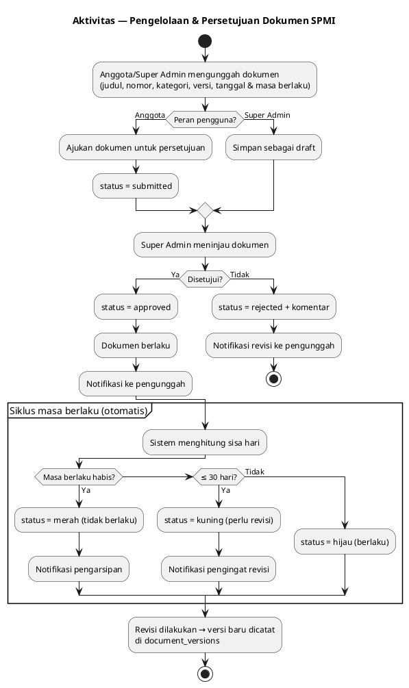
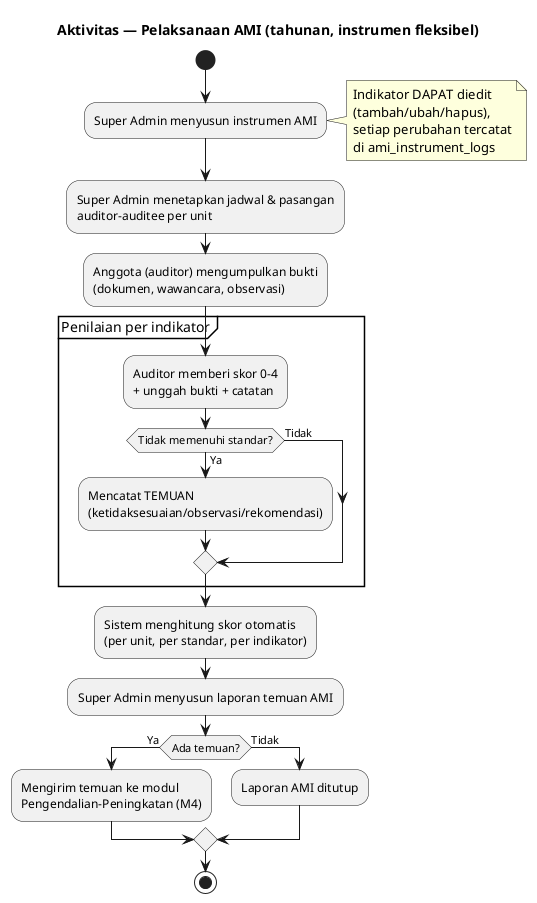
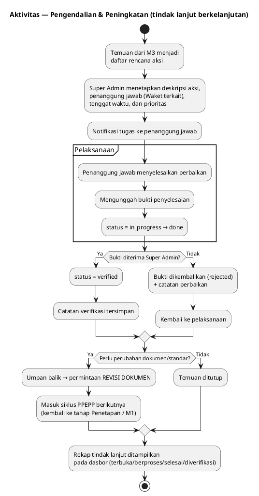
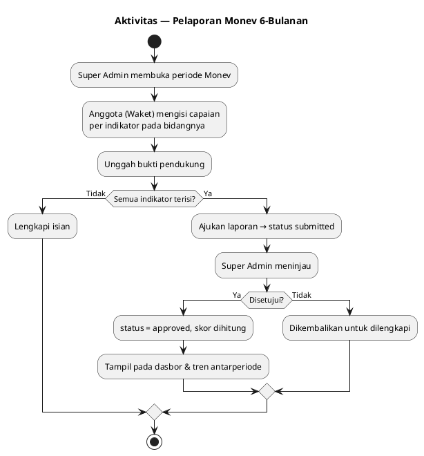

# 05 — DIAGRAM AKTIVITAS (3 ALUR UTAMA)

> Salin tiap blok ke https://www.plantuml.com/plantuml/uml atau StarUML → ekspor PNG → `skripsi/05-gambar/gambar-4-x-aktivitas-*.png`

---

## A. Alur Pengelolaan & Persetujuan Dokumen (M1) — mendukung tahap Penetapan

---

## B. Alur Evaluasi Mutu: AMI Tahunan (M3) — mendukung tahap Evaluasi

---

## C. Alur Tindak Lanjut Berkelanjutan (M4) — mendukung tahap Pengendalian & Peningkatan

---

## D. Alur pengisian Monev (M2) — pendukung tahap Pelaksanaan (ringkas)

